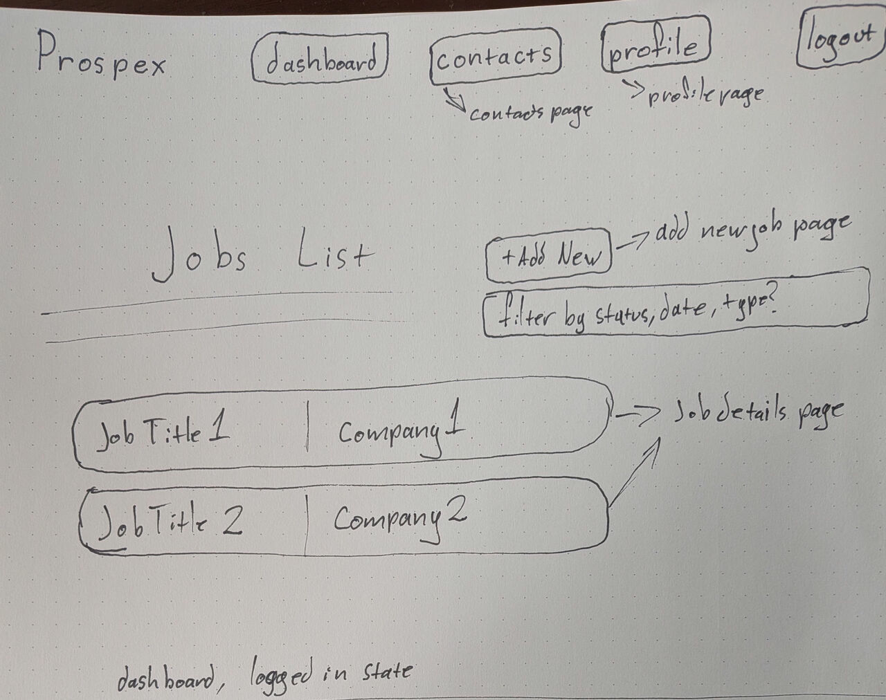
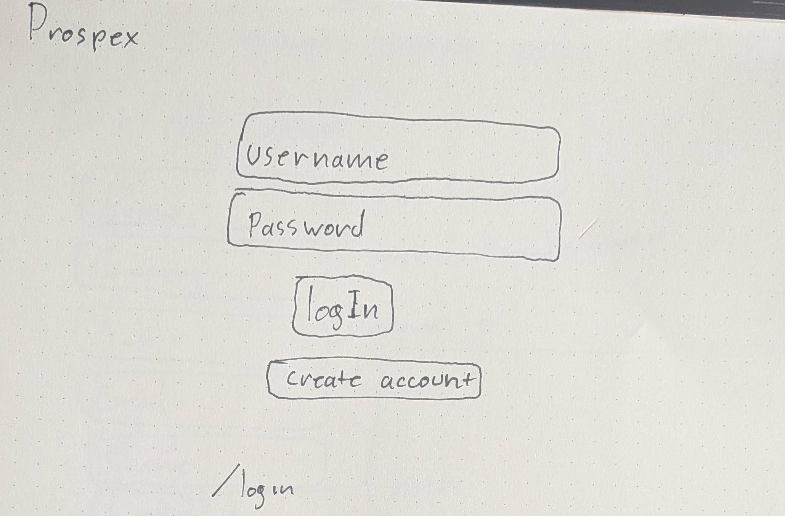
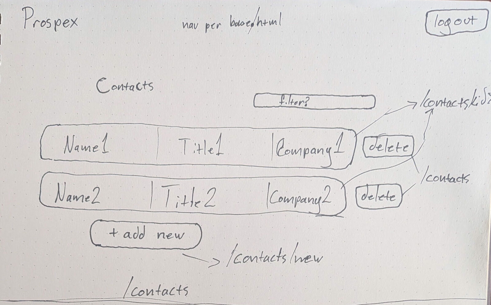
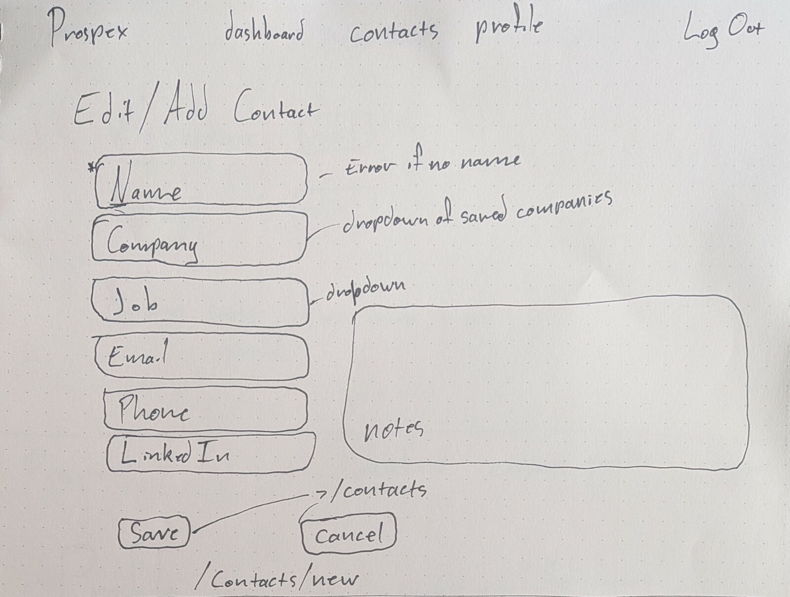
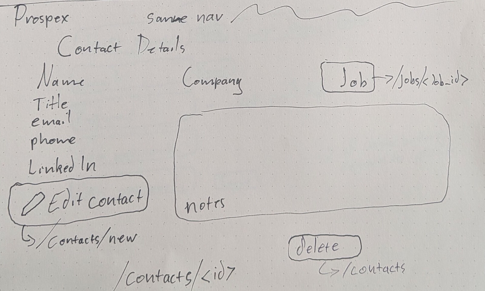
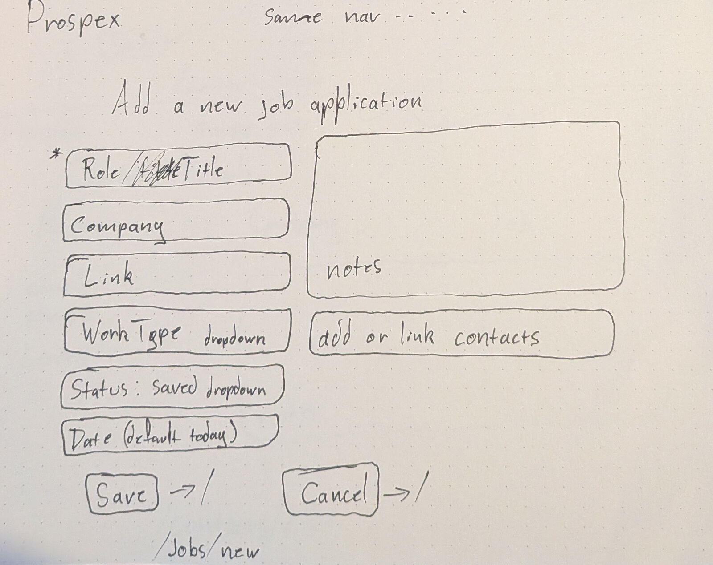
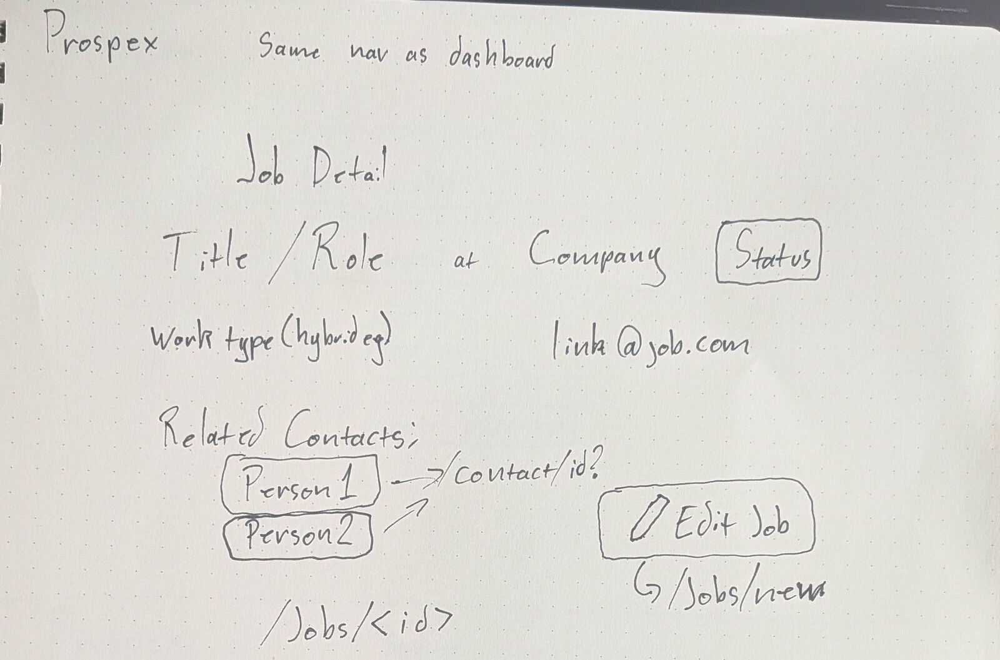
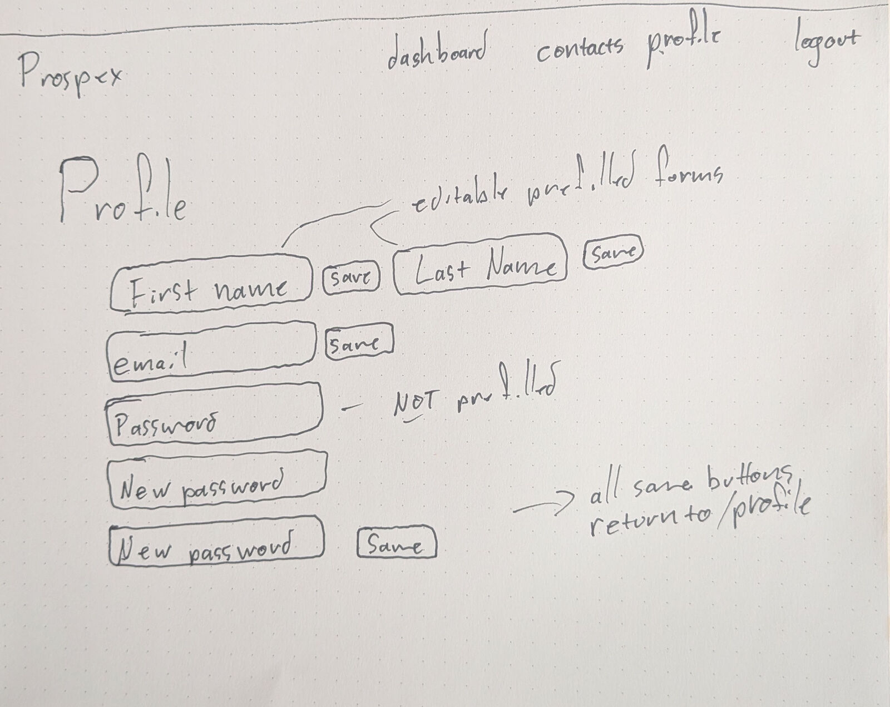

# PAGE_TESTING.md

**Nav bar** At the top of every page via shared 'base.html'
- links to dashboard, contacts, profile and log out when logged in. 

--- 

## 1. Dashboard
**Route:** `/`

**Description:** The homepage for Prospex which shows the most central feature--the user's list of jobs. Logged-out users see a prompt to log in. Logged in users see a list of job applications highlighting the Role/Title and Company for each. The list of cards is sorted by job status and can optionally be filtered to show jobs matching for a focused job view. The last card in the list is an "Add Job" button to add new job applications.

**Parameters:**
- Route: None
- Query: optional filter status (preferably implementing this with JavaScript)

**Data needed:**
- Session - `user_id` / isLoggedIn status
- Database - `get_jobs_for_user(user_id)`
    - returns list of user's jobs

**Links:**
- Individual job card - `jobs/<id>` each job card is a link to its own Job Detail page
- Add Job - `/jobs/add` last card links to Add Job page

**Tests:**
1. User not logged in - redirect to (`/login`).
2. Page displays list of all jobs
3. Each job card shows Role, Company, and Status (indicated by color)
4. Filter status selection appears above job list
    - Changing filter value updates job list
5. individual job cards link correctly to their specific job detail page
6. add job button links correctly
    - Add Job button displays if job list is empty
7. Navigation / Header - Page should display navigation with project title, links to contacts and profile pages, and a logout button.

---
## 2. Login
**Route:** `/login`

**Description:** Fields for password and username allow user to either log in or create a new account using the respective buttons. Successful login/account creation takes user to dashboard, otherwise they stay on this page.

**Parameters:**
- GET: none.
- POST, form fields:
  - `email` (str, required): lowercased and trimmed by the app before lookup.
  - `password` (str, required).
  - `action` (str): "login" or "signup", set by the name/value of the button clicked.
  - Signup only: `first_name` (str, required), `last_name` (str, required), `display_name` (str, optional; an empty value is saved as NULL, not "").

**Data needed:**
- Table accessed: `users`.
- Log in: look up one user by lowercased `email`, then check `password` against `password_hash` (`check_password_hash`). On success, store `user_id` in the session (not only the username).
- Sign up: insert a user with `first_name`, `last_name`, `email`, `display_name`, and `generate_password_hash(password)`. Catch the UNIQUE violation on `email` or `display_name` and show a friendly error.
- Access methods needed: `get_user_by_email(email)`, `create_user(first_name, last_name, email, password_hash, display_name=None)`.

**Links:**
- Success (login or signup): redirect to Dashboard (`/`).
- Failure: stay on `/login` with an error message and the typed email kept in the field.
- A user who is already logged in and opens `/login` is redirected to `/`.
- Log out (`/logout`) clears the session and returns to `/`.

**Tests:**
1. GET `/login` returns 200 and shows the form with both buttons.
2. Log in with a valid email and password (e.g., `alex.demo@example.com` / `DemoPass123!`) redirects to `/` and the session holds Alex's `user_id`.
3. Log in with the right email in different case (`ALEX.DEMO@example.com`) succeeds.
4. Log in with a wrong password stays on `/login`, shows an error, and creates no session.
5. Log in with an unknown email gives the same generic error as test 4, so the page doesn't reveal which emails exist.
6. Sign up with valid fields creates one new `users` row, logs the user in, and redirects to `/`.
7. The new row's `password_hash` is a hash, not the plain password.
8. Sign up with an email that already exists (including different case) stays on `/login`, shows an error, and adds no row.
9. Sign up with a missing `first_name`, `last_name`, or `password` shows an error and adds no row.
10. Sign up with a `display_name` already in use shows an error and adds no row.
11. Two sign-ups with a blank `display_name` both succeed (stored as NULL).
12. A logged-in user who opens `/login` is redirected to `/`.
13. `/logout` clears the session; the nav bar goes back to its logged-out state.

---
## 3. Contacts
**Route:** `/contacts`

**Description:** Provides a list of contacts with name, title and company displayed. An 'add new button' takes user to the add new contact page, see below. Clicking on a contact takes the user to the details page for that particular contact. 

**Parameters:** 

- Route: none
- Query: none (filtering is a possible stretch goal)

**Data needed:** 
  - On delete: `delete_contact(user_id, contact_id)` 

Session: `user_id`
- Database: `get_contacts_for_user(user_id)` returns each contact's id, name, title, and company name
    - Uses a LEFT JOIN to companies so contacts with no company still appear
    - Sorted alphabetically by name
    - On delete `delete_contact(user_id, contact_id)

**Links:** 

- Contact row →`/contacts/<id>`
- Add new → `/contacts/add`
- Log out → `/logout`
- Nav bar → per `base.html`
- Delete (each row) -> confirmation, then POST to `/contacts/<id>/delete`; returns to `/contacts`

**Tests:** 

1. Not logged in redirects to `/login`
2. Page loads with "Contacts" heading and "Add new" button
3. Each contact shows name, title, and company
4. Only the logged-in user's contacts appear
5. Contact with no title or company still appears; empty fields are blank, not "None"
6. User with no contacts sees an empty-state message; Add button still shows
7. Clicking a contact opens its detail page
8. "Add new" opens `/contacts/add`
9. Each contact row shows a Delete button
10. The confirmation names the contact being deleted
11. Confirming removes only that contact; the rest of the list is unchanged
12. Cancelling the confirmation keeps the contact
13. Clicking Delete does not open the contact's details page
14. Deleting the last contact shows the empty-state message

---
## 4. Add / Edit Contact
**Route:** `/contacts/add`, `/contacts/<id>/edit`

**Description:** Form allows user to save information about a new contact. Name is mandatory. Company, title, email, phone and Linked In are optional. A text field is provided for any relevant notes. Returns to /contacts on save or cancel. 

**Parameters:** 

- Add (`/contacts/add`): none
- Edit (`/contacts/<id>/edit`): route parameter `contact_id`
- Form data on submit (POST), both modes:
    - `name` (required)
    - `title`, `designation`, `company_id`, `job_id`, `email`, `phone`, `linkedin_url`, `notes` (optional)
  - `new_company_name` (used only when "+ Add new company" is selected)

**Data needed:** 

- Session: `user_id`
-Database:
    - `get_companies_for_user(user_id)` for Company dropdown
    - `new_company_name
    - `get_jobs_for_user(user_id)` for Job dropdown
    - Edit only: `get_contact(user_id, contact_id)` to prefill the form
    - On submit: `create_contact(...)` (add) or `update_contact(...)` (edit)
    - On submit, if "+ Add new company" is selected: `get_or_create_company(user_id, new_company_name)`, then its id is saved as the contact's `company_id`
        -(possible stretch goal → expand function to add city, region, website, notes or add an "Edit Companies" page)
- Static: designation options for dropdown
- Form state: validation error message and previously entered values

**Links:** 

- Save (add) → `/contacts`
- Save (edit) → `/contacts/<id>`
- Cancel → `/contacts` (add) or `/contacts<id>` (edit); nothing is saved
- Nav bar → (dashboard, contacts, profile) -> their pages
- Log Out → `/logout`

**Tests:** 

1. Not logged in: redirects to `/login`
2. All fields render; Name is required
3. Company and Job dropdowns list only the logged-in user's companies and jobs, plus a "None" option, and "+ Add Company" that shows a company name field for companies only 
4. Submitting without a name shows an error, saves nothing, and keeps the other entered values
5. Submitting with only a name succeeds
6. A valid submit creates the contact, redirects to `/contacts`, and the new contact appears in the list
7. Cancel saves nothing and returns to the previous page
8. Submitting a `company_id` or `job_id` belonging to another user is rejected
9. Edit: form is prefilled with the contact's current values
10. Edit: saving changes updates the contact and redirects to its details page
11. Edit: using another user's `contact_id` returns "not found"
12. Selecting "+ Add new company" with a name creates the company and links the contact to it
13. Entering an existing company's name in any capitalization reuses that company instead of creating a duplicate
14. Selecting "+ Add new company" with a blank name shows an error and saves nothing

---
## 5. Contact Details
**Route:** `/contacts/<id>`

**Description:** Displays saved details regarding a given contact. Name, company and associated job application as well as role, contact information and relevant notes.

**Parameters:** 

- Route: `contact_id` from `/contacts/<id>`

**Data needed:** 

-Session: `user_id`
-Database:
    - `get_contact(user_id, contact_id)`
    - On delete `delete_contact(user_id, contact_id)

**Links:** 

- Job -> `/jobs/<job_id>` (only shown if a job is linked)
- Edit -> `/contacts/<id>/edit`
- Delete -> confirmation, then POST to `/contacts/<id>/delete`; redirects to `/contacts`
- Back to contacts -> `/contacts`
- Nav bar -> per `base.html`

**Tests:** 

1. Not logged in: redirects to `/login`
2. Shows the contact's name, title, designation, company, job, email, phone, LinkedIn, and notes
3. Empty optional fields display as blank, not "None"
4. Job title links to the correct job page; no link shown when no job is linked
5. Nonexistent `contact_id` returns "not found"
6. Another user's `contact_id` returns "not found" and shows none of their data
7. Edit opens `/contacts/<id>/edit` with the form prefilled
8. Delete asks for confirmation; confirming removes the contact and returns to `/contacts`
9. Cancelling the confirmation keeps the contact
10. Deleting another user's contact fails and leaves it unchanged

---
## 6. Add / Edit Job
**Routes:** `/jobs/add`, `/jobs/<id>/edit`

**Description:** An input form for saving a new job or editing an existing job. It should prompt the logged-in user for job details, some of which are required. New jobs should have status as a dropdown option as users may add an application that's already in progress.

The text inputs are role/title, company, application link. The dropdown inputs are work type, status, and contacts. There is a datepicker input for the date that defaults to the current date. The textbox input allows for more detailed comments and notes.

**Parameters:**
- Route (Add): None
- Route (Edit): `job_id` for existing job

**Data needed:**
- Session - `user_id` / isLoggedIn status
- Job - `get_job(user_id, job_id)`
- Contacts - list of associated contacts for company
  - MVP - `get_contacts_for_job(user_id, job_id)` - for Edit Mode only
  - Reach - after user types in company name, search DB for matching contacts. Input needs to be debounced to prevent back-to-back searches

**Links:**
- Save - check and submit form then redirect to Job Details `jobs/<id>`
- Cancel - discard changes and redirect to:
    - (Add Mode) - Dashboard (`/`)
    - (Edit Mode) - Job Details (`/jobs/<id>`)

**Tests:**
1. User not logged in - redirect to Login (`/login`)
2. Form input fields should be of correct type
    - Raise validation error if wrong type or null
    - Forms should be pre-filled for Edit Mode
3. Submit button should display "Save" for Add Mode and "Update" for Edit Mode
4. On submit,
    - form should not submit if any fields are invalid
    - redirect to Job Details (`/jobs/<id>`)
5. On cancel, discard form input and redirect to correct page
    - Dashboard (`/`) for Add Mode
    - Job Details (`/jobs/<id>`) for Edit Mode

---
## 7. Job Details
**Route:** `jobs/<id>`

**Description:** Displays details of a given job. Title, company, status, type, link, notes and a list of connected contacts. Edit button will be added to open same job in the add/edit form. 

**Parameters:**
- `job_id` (int, URL path): must be a whole number.
- Session `user_id`: required. A logged-out visitor is redirected to `/login`.

**Data needed:**
- Tables accessed: `jobs`, `companies`, `contacts`. Every query also filters on the session `user_id`.
- Job: `title`, `status`, `work_type`, `link`, `notes`, `date_applied`, joined to the company's `name`, `city`, `region`.
- Linked contacts: `id`, `name`, `title`, `designation` for contacts where `job_id` = the job and `user_id` = the session user.
- Access methods needed: `get_job(user_id, job_id)` (returns the job with its company, or None) and `get_contacts_for_job(user_id, job_id)` (returns a list, possibly empty).
- Empty values (NULL `link`, `work_type`, `notes`, `date_applied`, or company `city`/`region`) are left out or shown as a dash. The page never shows "None".

**Links:**
- Edit button goes to `/jobs/<id>/edit`.
- Each contact goes to `/contacts/<id>`.
- A "back to dashboard" link goes to `/`.

**Tests:**
1. A logged-in user opening one of their own jobs gets a 200 and sees the title, company, status, work type, link, and notes.
2. A job with linked contacts lists each of them, and each one links to `/contacts/<id>`.
3. A job with no linked contacts shows an empty-contacts message instead of a blank list.
4. A job with empty optional fields (link, notes, work type, date applied) returns 200 and shows no "None" text.
5. A company with no city or region shows just the company name, with no stray comma.
6. A job id that doesn't exist returns 404.
7. A job owned by another user returns the same 404 and shows none of its data.
8. Contacts belonging to another user never appear, even if a contact row points at this job.
9. A logged-out visitor is redirected to `/login`.
10. A non-numeric id (e.g., `/jobs/abc`) returns 404.
11. The Edit button points to `/jobs/<id>/edit` for the right job.
12. A job link starting with http:// or https:// opens in a new tab; any other kind of link is not rendered as clickable.

---
## 8. Profile
**Route:** `user/<username>`

**Description:** Shows logged-in user's first name, last name, email in pre-filled editable forms with save buttons to change either. Change password form also displayed. The password and hash are never shown. Possibly display some additional stats as a stretch goal for this page.

**Parameters:** 

- Route Parameters: None (user comes from session)

- Form data on edits (POST):
    - `first_name` (required)
    - `last_name` (required)
    - `email` (required)
- password form:   `(profile/password)`
    - `current_password` (required)
    - `new_password` (required)
    - `confirmation` (required, must match new)

**Data needed:** 

- Session: `user_id`
- Database:
    - `get_user(user_id)` to fill forms with `email`, `first_name`, `last_name`.
    - `update_user(user_id, first_name, last_name, email)` to change email and/or name
    - `change_password(user_id, current_password, new_password)` change the password

**Links:** 

- Edit → `/profile` GET shows the saved info, POST updates name, email and redirects back to profile
- Change password → `/profile/password` changes password and redirects back to profile

**Tests:** 

1. Logged in GET for `/profile` returns 200
2. Logged out GET or POST does not change db and redirects to `/login`
3. Shows the correct first name, last name and email for the logged in user
4. password not accessible in html

- Editing
5. valid inputs for name, email save to db, redirect to `/profile` and page shows new info
6. if any required field is empty on POST, error displayed, nothing saved to db
7. email already in use: error displayed, nothing saved
8. email in different case (M.cspb vs m.cspb): error, no save
9. changing other fields without changing email does not result in error

- Password

10. unchanged password results in no changes on save
11. matching new passwords result new saved password  with displayed message "password changed"
12. wrong current password entered: Error, no change in db
13. new and confirmation don't match: Error, no change
