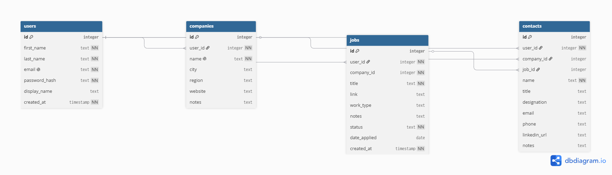

# SQL_TESTING.md
## Project Milestone 5: SQL Design
**Project:** Prospex (Job Search Tracker)

**Team:** CSPB 3308 Group 3

**Purpose:** Database design and testing specification for developers

---

## Overview

This document describes the database design for Prospex: the tables, their fields and constraints, how they relate, the functions used to access the data, and the tests that verify each piece. It is written for the developers building the Flask backend and pages, so they can build against one agreed design.

**Database:** SQLite

**Accessed from:** Flask backend via Python's built-in `sqlite3` module, through a data access layer of Python functions that hide the SQL 

### Design Decisions

| Decision | Choice | Reason |
|---|---|---|
| Login | Users log in with email; email is UNIQUE and lowercased by the app before saving or lookup | Realistic, and allows password reset later; lowercasing prevents duplicate accounts that differ only by case |
| Jobs table | One `jobs` table. Status defaults to 'saved'; `date_applied` is nullable | Applying only adds a date and a status change, so a separate applications table would hold almost nothing |
| Status | Column on `jobs` with a CHECK constraint: saved, applied, interviewing, offer, rejected, accepted, declined, withdrawn | Short, fixed list with no data of its own; CHECK blocks invalid values at the database level |
| Companies | `companies` table referenced by `jobs` and `contacts`; UNIQUE per user on name | Reliable "who I know at this company"; prevents duplicate company names per user |
| Adding companies | App handles "pick existing or add company": the route looks up the company by name and creates it if missing, in the same transaction as the job insert | Keeps business logic in the app, not in database triggers |
| Contacts in MVP | Yes. Each contact has an optional link to one job, plus a designation (e.g., referrer, recruiter, interviewer, hiring manager) | The vision promises tracking "applications and connections"; one job per contact keeps the MVP simple |
| Deleting a user | ON DELETE CASCADE to all of their rows | Deleting an account removes all of that user's data |
| Deleting a company | `jobs.company_id` uses NO ACTION (SQLite default); `contacts.company_id` uses SET NULL | NO ACTION blocks deleting a company that still has jobs, but is checked at the end of the statement, so a user's cascade delete always succeeds. RESTRICT was rejected because it is checked immediately and can block the user cascade depending on table creation order. Contacts are kept when their company is deleted |
| Deleting a job | Contacts' `job_id` is SET NULL | The person stays in the user's network even if the job is removed |
| Contacts without a company | Allowed (`company_id` nullable) | Covers people met at meetups or events with no company tie |
| Location and work type | `city` and `region` on `companies`; `work_type` (remote, hybrid, in person) on `jobs` | Location is recorded once per company; work arrangement varies by job |
| Date applied | `date_applied` is nullable and set or edited manually by the user; no CHECK ties it to status | Users often log applications after the fact, so they need full control of the date; keeps the schema simple |
| Status history | Stretch goal (see below) | Adds a table beyond the agreed MVP scope |
| File uploads (CV, cover letter) | Stretch goal; would add a `documents` table (one job, many documents) | Upload handling and storage on free hosts is a project of its own |
| Database | SQLite | Matches Lab 7, so the whole team will know it; no install needed; fresh test databases are easy to create in unit tests |
| Foreign key enforcement | Every connection runs `PRAGMA foreign_keys = ON` | SQLite ignores foreign keys by default; without this, CASCADE, RESTRICT, and SET NULL silently do nothing |
| Primary keys | Explicit `id INTEGER PRIMARY KEY` on every table | Auto-generates ids without relying on SQLite's implicit rowid |
| Naming convention | Plural snake_case table names; primary key `id`; foreign keys `<singular table>_id` (e.g., `user_id`) | Standard practice; consistent across all tables |
| Data ownership | Every `companies`, `jobs`, and `contacts` row references `users.id` | Users only ever see their own data |

### Known Trade-offs (MVP)
- SQLite stores the database as a file on the server. Some free hosts wipe local files on restart or redeploy, so the deployment setup must keep the file (revisit when the course covers cloud deployment). A seed script will rebuild demo data in one command.
- A contact linked to more than one job must be entered twice (a `job_contacts` join table would fix this later).
- Only the applied date is stored, not when other status changes happened (see Stretch: Status History).
- A user must delete or move a company's jobs before deleting the company itself.
- Location is stored once per company, not per job. Jobs at a company's other offices can't show their own city (a per-job location field would fix this later).

### Stretch: Status History (possible addition)
Records the date of every status change, which enables stats like time from applied to interview.

**What would change:**
- **New table `job_status_history`:** one row per status change.
  - `id`: INTEGER, primary key
  - `job_id`: INTEGER, FK → `jobs.id`, NOT NULL, ON DELETE CASCADE
  - `status`: TEXT, NOT NULL, same CHECK list as `jobs.status`
  - `changed_at`: DATE, NOT NULL, DEFAULT today; editable, since users often log a change after it happened
- **`jobs.date_applied` would be removed.** The applied date becomes the history row where status = 'applied'. Storing it in both places lets them disagree.
- **`jobs.status` stays** as the current status, so dashboard queries don't need to search the history.
- **The app writes two rows on every status change:** it updates `jobs.status` and inserts a history row, in one transaction.
- **A history row is inserted when a job is created,** with status 'saved'.
- **New access methods and tests:** e.g., get the history for a job, plus a test that a status change creates exactly one history row.

### Entity Relationship Diagram

[View and edit on dbdiagram.io](https://dbdiagram.io/d/Prospex-database-schema-SQLite-6ac692d3a5ab28041913c48e)

---

# Database Tables

Tables in the MVP:
- `users`
- `companies`
- `jobs`
- `contacts`

### Relationships Summary
- A user has many companies, jobs, and contacts.
- A company has many jobs and many contacts.
- Each job belongs to one company.
- A job has zero or more contacts.
- A contact has zero or one job, and zero or one company.

---

## 1) Table: users

### Table Description
Stores individual users so that only an individuals own data is available to them. 

### Fields
| Field Name | Type | Description | Constraints |
|---|---|---|---|
| id | INTEGER | [auto-incremented id code ] | PRIMARY KEY (auto-generated) |
| first_name | TEXT | [the user's typed first name] | NOT NULL| 
|last_name | TEXT | [the user's typed last name] | NOT NULL |
| email | TEXT | [  the user's email address] | NOT NULL, UNIQUE; lowercased by the app |
| password_hash | TEXT | [hashkey to password for login ] | NOT NULL |
| display_name | TEXT | [the user's preferred display name] | UNIQUE |
| created_at | TIMESTAMP | [records date of user creation ] | NOT NULL, DEFAULT current timestamp |

### Relationships
- One-to-many with `companies`, `jobs`, and `contacts` (ON DELETE CASCADE)

### Table Tests

All tests are in `test_schema.py` (class `TestUsers`). Each test runs on a fresh in-memory database built from `schema.sql` with `PRAGMA foreign_keys = ON`.

#### Users #1

**Use Case Name:** Insert a valid user succeeds (`test_insert_valid_user`)  
**Pre-conditions:** Empty `users` table  
**Test Steps:**
1. Insert a user with first_name, last_name, email, password_hash, and display_name
2. Select the user by email

**Expected Result:** Row exists and every column matches the inserted values  
**Actual Result:** Row found; all five values saved unchanged  
**Status:** Pass

#### Users #2

**Use Case Name:** Insert user with missing email fails (`test_insert_user_missing_email`)  
**Pre-conditions:** Empty `users` table  
**Test Steps:**
1. Insert a user with every required field except email

**Expected Result:** `IntegrityError`: NOT NULL constraint failed: users.email  
**Actual Result:** `IntegrityError` raised with the expected message  
**Status:** Pass

#### Users #3

**Use Case Name:** Insert user with missing first_name or last_name fails (`test_insert_user_missing_name`)  
**Pre-conditions:** Empty `users` table  
**Test Steps:**
1. Insert a user without first_name
2. Insert a user without last_name

**Expected Result:** Each insert raises `IntegrityError`: NOT NULL constraint failed on the missing column  
**Actual Result:** Both inserts raised `IntegrityError` naming `users.first_name` and `users.last_name`  
**Status:** Pass

#### Users #4

**Use Case Name:** Insert user with missing password hash fails (`test_insert_user_missing_password`)  
**Pre-conditions:** Empty `users` table  
**Test Steps:**
1. Insert a user with every required field except password_hash

**Expected Result:** `IntegrityError`: NOT NULL constraint failed: users.password_hash  
**Actual Result:** `IntegrityError` raised with the expected message  
**Status:** Pass

#### Users #5

**Use Case Name:** Insert user with an existing email fails, including different case (`test_insert_user_existing_email`)  
**Pre-conditions:** One user exists with email `ozzy@example.com`  
**Test Steps:**
1. Insert a second user with `ozzy@example.com`
2. Insert a second user with `Ozzy@Example.com`
3. Count rows in `users`

**Expected Result:** Both inserts raise `IntegrityError`: UNIQUE constraint failed: users.email; only 1 user remains  
**Actual Result:** Both inserts rejected; user count is 1  
**Status:** Pass

#### Users #6

**Use Case Name:** New user gets an auto-generated id and created_at (`test_id_timestamp_at_creation`)  
**Pre-conditions:** Empty `users` table  
**Test Steps:**
1. Insert two users without supplying id or created_at
2. Select id and created_at for each

**Expected Result:** Each id is an integer and the two ids differ; each created_at is set in `YYYY-MM-DD HH:MM:SS` format  
**Actual Result:** Unique integer ids generated; both timestamps present in the expected format  
**Status:** Pass

#### Users #7

**Use Case Name:** Deleting a user deletes their company, job, and contact (`test_cascade_on_delete_user`)  
**Pre-conditions:** One user with one company, one job at that company, and one contact linked to both  
**Test Steps:**
1. Confirm one row per table belongs to the user
2. Delete the user
3. Count the user's rows in every table

**Expected Result:** Delete succeeds (CASCADE works even though the job still references the company); 0 rows remain in `users`, `companies`, `jobs`, and `contacts`  
**Actual Result:** Delete succeeded; all four counts are 0  
**Status:** Pass

---

## 2) Table: jobs

### Table Description
Stores individual jobs entered by the user.

### Fields
| Field Name | Type | Description | Constraints |
|---|---|---|---|
| id | INTEGER | auto-incremented id code | PRIMARY KEY (auto-generated) |
| user_id | INTEGER | id of the user that added job | FK → users.id, NOT NULL, ON DELETE CASCADE |
| company_id | INTEGER | id of company offering job | FK → companies.id, NOT NULL, ON DELETE NO ACTION |
| title | TEXT | job title | NOT NULL |
| link | TEXT | link to the post for added job | Nullable |
| work_type | TEXT | indicates remote work status of job | Nullable, CHECK (remote, hybrid, in person) |
| notes | TEXT | space for any notes a user wants to add | Nullable |
| status | TEXT | application status for job | NOT NULL, DEFAULT 'saved', CHECK (saved, applied, interviewing, offer, rejected, accepted, declined, withdrawn) |
| date_applied | DATE | date application sent | Nullable; entered or edited manually by the user |
| created_at (optional) | TIMESTAMP | job creation date | NOT NULL, DEFAULT current timestamp |

### Relationships
- Many-to-one with `users`
- Many-to-one with `companies`
- One-to-many with `contacts`

### Table Tests

All tests are in `test_schema.py` (class `TestJobs`). Each test starts with a fresh database containing one user and one company owned by that user.

#### Jobs #1

**Use Case Name:** Insert a valid job succeeds (`test_insert_valid_job`)  
**Pre-conditions:** One user and one company exist  
**Test Steps:**
1. Insert a job with every column filled in (status 'applied', work_type 'in person')
2. Select the job by id

**Expected Result:** Row exists and every column matches the inserted values  
**Actual Result:** Row found; all eight values saved unchanged  
**Status:** Pass

#### Jobs #2

**Use Case Name:** Insert job with missing title fails (`test_insert_job_missing_title`)  
**Pre-conditions:** One user and one company exist  
**Test Steps:**
1. Insert a job with every column except title

**Expected Result:** `IntegrityError`: NOT NULL constraint failed: jobs.title  
**Actual Result:** `IntegrityError` raised with the expected message  
**Status:** Pass

#### Jobs #3

**Use Case Name:** Insert job with missing company_id fails (`test_insert_job_missing_companyid`)  
**Pre-conditions:** One user and one company exist  
**Test Steps:**
1. Insert a job with every column except company_id

**Expected Result:** `IntegrityError`: NOT NULL constraint failed: jobs.company_id  
**Actual Result:** `IntegrityError` raised with the expected message  
**Status:** Pass

#### Jobs #4

**Use Case Name:** Insert job with a company_id that doesn't exist fails (`test_insert_job_nonexistent_companyid`)  
**Pre-conditions:** One user and one company exist; no company has id 9999  
**Test Steps:**
1. Insert a job with company_id 9999

**Expected Result:** `IntegrityError`: FOREIGN KEY constraint failed  
**Actual Result:** `IntegrityError` raised with the expected message  
**Status:** Pass

#### Jobs #5

**Use Case Name:** Insert job with a user_id that doesn't exist fails (`test_insert_job_nonexistent_userid`)  
**Pre-conditions:** One user and one company exist; no user has id 9999  
**Test Steps:**
1. Insert a job with user_id 9999

**Expected Result:** `IntegrityError`: FOREIGN KEY constraint failed  
**Actual Result:** `IntegrityError` raised with the expected message  
**Status:** Pass

#### Jobs #6

**Use Case Name:** Insert job with no status gets 'saved' by default (`test_insert_job_default_status`)  
**Pre-conditions:** One user and one company exist  
**Test Steps:**
1. Insert a job without the status column
2. Select the job's status

**Expected Result:** status is 'saved'  
**Actual Result:** status is 'saved'  
**Status:** Pass

#### Jobs #7

**Use Case Name:** Insert job with a status not on the list fails (`test_insert_job_unlisted_status`)  
**Pre-conditions:** One user and one company exist  
**Test Steps:**
1. Insert a job with status 'appiled' (misspelled)

**Expected Result:** `IntegrityError`: CHECK constraint failed  
**Actual Result:** `IntegrityError` raised with the expected message  
**Status:** Pass

#### Jobs #8

**Use Case Name:** Insert job with a work_type not on the list fails (`test_insert_job_unlisted_worktype`)  
**Pre-conditions:** One user and one company exist  
**Test Steps:**
1. Insert a job with work_type 'in persone' (misspelled)

**Expected Result:** `IntegrityError`: CHECK constraint failed  
**Actual Result:** `IntegrityError` raised with the expected message  
**Status:** Pass

#### Jobs #9

**Use Case Name:** Insert job with no date_applied, link, notes, or work_type succeeds (`test_insert_job_missing_nullable_fields`)  
**Pre-conditions:** One user and one company exist  
**Test Steps:**
1. Insert a job with only user_id, company_id, title, and status
2. Select date_applied, link, notes, and work_type

**Expected Result:** Insert succeeds; all four optional columns are NULL  
**Actual Result:** Row found; all four columns are NULL  
**Status:** Pass

#### Jobs #10

**Use Case Name:** Deleting a job keeps its contacts but clears their job_id (`test_delete_job`)  
**Pre-conditions:** One user, one company, one job, and one contact linked to that job and company  
**Test Steps:**
1. Confirm the contact's job_id matches the job
2. Delete the job
3. Select the contact's job_id and company_id

**Expected Result:** Job is deleted; contact still exists with job_id NULL (SET NULL) and company_id unchanged  
**Actual Result:** Job deleted; contact kept with job_id NULL and the original company_id  
**Status:** Pass

---

## 3) Table: contacts

### Table Description
Stores network contacts that can be associated with specific jobs

### Fields
| Field Name | Type | Description | Constraints |
|---|---|---|---|
| id | INTEGER | auto-incremented id code | PRIMARY KEY (auto-generated) |
| user_id | INTEGER | id of user adding contact | FK → users.id, NOT NULL, ON DELETE CASCADE |
| company_id | INTEGER | id of company contact is from | FK → companies.id, nullable, ON DELETE SET NULL |
| job_id | INTEGER | job associated with contact | FK → jobs.id, nullable, ON DELETE SET NULL |
| name | TEXT | name of contact | NOT NULL |
| title | TEXT | job title of contact | Nullable |
| designation | TEXT | role of contact re. job appication | Nullable, CHECK (recruiter, referrer, interviewer, hiring manager, other) |
| email | TEXT | contact email address | Nullable (not unique) |
| phone | TEXT | contact phone number | Nullable; stored as text to keep +, dashes, parentheses |
| linkedin_url | TEXT | contact LinkedIn link  | Nullable |
| notes | TEXT | space for notes about the contact a user would like to add | Nullable |

### Relationships
- Many-to-one with `users`
- Many-to-one with `companies` (optional; link cleared if the company is deleted)
- Many-to-one with `jobs` (optional; link cleared if the job is deleted)

### Table Tests

All tests are in `test_schema.py` (class `TestContacts`). Each test starts with a fresh database containing one user, one company, and one job at that company.

#### Contacts #1

**Use Case Name:** Insert a valid contact succeeds (`test_insert_valid_contact`)  
**Pre-conditions:** One user, one company, and one job exist  
**Test Steps:**
1. Insert a contact with every column filled in, including phone `+1 (555) 666-7777`
2. Select the contact by id

**Expected Result:** Row exists and every column matches the inserted values; phone keeps its +, spaces, dashes, and parentheses  
**Actual Result:** Row found; all ten values saved unchanged  
**Status:** Pass

#### Contacts #2

**Use Case Name:** Insert contact with missing name fails (`test_insert_contact_missing_name`)  
**Pre-conditions:** One user, one company, and one job exist  
**Test Steps:**
1. Insert a contact with every column except name

**Expected Result:** `IntegrityError`: NOT NULL constraint failed: contacts.name  
**Actual Result:** `IntegrityError` raised with the expected message  
**Status:** Pass

#### Contacts #3

**Use Case Name:** Insert contact with only a name succeeds (`test_insert_contact_missing_nullables`)  
**Pre-conditions:** One user exists  
**Test Steps:**
1. Insert a contact with only user_id and name
2. Select the contact by id

**Expected Result:** Insert succeeds; name is saved; company_id, job_id, title, designation, email, phone, linkedin_url, and notes are all NULL  
**Actual Result:** Row found; name saved; all eight optional columns are NULL  
**Status:** Pass

#### Contacts #4

**Use Case Name:** Insert contact with a company_id that doesn't exist fails (`test_insert_contact_nonexistent_companyid`)  
**Pre-conditions:** One user, one company, and one job exist; no company has id 9999  
**Test Steps:**
1. Insert a contact with company_id 9999

**Expected Result:** `IntegrityError`: FOREIGN KEY constraint failed  
**Actual Result:** `IntegrityError` raised with the expected message  
**Status:** Pass

#### Contacts #5

**Use Case Name:** Insert contact with a job_id that doesn't exist fails (`test_insert_contact_nonexistent_jobid`)  
**Pre-conditions:** One user, one company, and one job exist; no job has id 9999  
**Test Steps:**
1. Insert a contact with job_id 9999

**Expected Result:** `IntegrityError`: FOREIGN KEY constraint failed  
**Actual Result:** `IntegrityError` raised with the expected message  
**Status:** Pass

#### Contacts #6

**Use Case Name:** Insert contact with a designation not on the list fails (`test_insert_contact_unlisted_designation`)  
**Pre-conditions:** One user, one company, and one job exist  
**Test Steps:**
1. Insert a contact with designation 'hiring managers' (not on the list)

**Expected Result:** `IntegrityError`: CHECK constraint failed  
**Actual Result:** `IntegrityError` raised with the expected message  
**Status:** Pass

#### Contacts #7

**Use Case Name:** Two contacts with the same email succeed (`test_insert_contact_duplicate_email`)  
**Pre-conditions:** One user exists  
**Test Steps:**
1. Insert two contacts with different names and the email `recruiting@example.com`
2. Count contacts with that email

**Expected Result:** Both inserts succeed; count is 2  
**Actual Result:** Both inserts succeeded; count is 2  
**Status:** Pass

---

## 4) Table: companies

### Table Description
Stores companies offering jobs in jobs table

### Fields
| Field Name | Type | Description | Constraints |
|---|---|---|---|
| id | INTEGER | auto-incremented id code | PRIMARY KEY (auto-generated) |
| user_id | INTEGER | id of user adding company | FK → users.id, NOT NULL, ON DELETE CASCADE |
| name | TEXT | Company name | NOT NULL; COLLATE NOCASE; UNIQUE together with user_id |
| city | TEXT | City where company is located | Nullable |
| region | TEXT | region where company is located | Nullable; state, province, or country (works for non-US locations) |
| website | TEXT | company website | Nullable |
| notes | TEXT | space for notes about company a user would add | Nullable |

### Relationships
- Many-to-one with `users`
- One-to-many with `contacts` (ON DELETE SET NULL)
- One-to-many with `jobs (ON DELETE NO ACTION)

### Table Tests

All tests are in `test_schema.py` (class `TestCompanies`). Each test starts with a fresh database containing one user.

#### Companies #1

**Use Case Name:** Insert a valid company succeeds (`test_insert_valid_company`)  
**Pre-conditions:** One user exists  
**Test Steps:**
1. Insert a company with every column filled in
2. Select the company by id

**Expected Result:** Row exists and every column matches the inserted values  
**Actual Result:** Row found; all six values saved unchanged  
**Status:** Pass

#### Companies #2

**Use Case Name:** Insert company with missing name fails (`test_insert_company_missing_name`)  
**Pre-conditions:** One user exists  
**Test Steps:**
1. Insert a company with every column except name

**Expected Result:** `IntegrityError`: NOT NULL constraint failed: companies.name  
**Actual Result:** `IntegrityError` raised with the expected message  
**Status:** Pass

#### Companies #3

**Use Case Name:** Insert company with a user_id that doesn't exist fails (`test_insert_company_nonexistent_userid`)  
**Pre-conditions:** One user exists; no user has id 9999  
**Test Steps:**
1. Insert a company with user_id 9999

**Expected Result:** `IntegrityError`: FOREIGN KEY constraint failed  
**Actual Result:** `IntegrityError` raised with the expected message  
**Status:** Pass

#### Companies #4

**Use Case Name:** Insert a company name the same user already has fails, including different case (`test_insert_company_duplicate_name`)  
**Pre-conditions:** The user already has a company named "Black Sabbath"  
**Test Steps:**
1. Insert "Black Sabbath" again for the same user
2. Insert "black sabbath" for the same user
3. Count rows in `companies`

**Expected Result:** Both inserts raise `IntegrityError`: UNIQUE constraint failed; only 1 company remains  
**Actual Result:** Both inserts rejected; company count is 1  
**Status:** Pass

#### Companies #5

**Use Case Name:** Two different users can each have a company with the same name (`test_insert_same_company_multiple_users`)  
**Pre-conditions:** Two users exist  
**Test Steps:**
1. Insert "Black Sabbath" for the first user
2. Insert "Black Sabbath" for the second user
3. Count companies named "Black Sabbath"

**Expected Result:** Both inserts succeed; count is 2  
**Actual Result:** Both inserts succeeded; count is 2  
**Status:** Pass

#### Companies #6

**Use Case Name:** New company gets an auto-generated id (`test_company_generated_id`)  
**Pre-conditions:** Two users exist  
**Test Steps:**
1. Insert two companies for the first user and one for the second, without supplying id
2. Select all company ids

**Expected Result:** Stored ids match the generated ids; each is an integer; all three are unique  
**Actual Result:** Three unique integer ids generated and stored  
**Status:** Pass

#### Companies #7

**Use Case Name:** Deleting a company that still has jobs fails (`test_delete_company_with_jobs`)  
**Pre-conditions:** One user, one company, and one job at that company  
**Test Steps:**
1. Confirm the company and job exist
2. Delete the company
3. Recount the company and its jobs

**Expected Result:** Delete raises `IntegrityError`: FOREIGN KEY constraint failed (NO ACTION); company and job both still exist  
**Actual Result:** Delete blocked; company and job counts are still 1  
**Status:** Pass

#### Companies #8

**Use Case Name:** Deleting a company with contacts (but no jobs) succeeds and clears their company_id (`test_delete_company_with_contacts`)  
**Pre-conditions:** One user, one company, and one contact linked to that company; no jobs  
**Test Steps:**
1. Confirm the contact's company_id matches the company
2. Delete the company
3. Recount the company, user, and contact, and select the contact's company_id

**Expected Result:** Company is deleted; user and contact still exist; contact's company_id is NULL (SET NULL)  
**Actual Result:** Company deleted; user and contact kept; contact's company_id is NULL  
**Status:** Pass

---

# Data Access Methods

Routes call these Python functions in `db.py` instead of writing SQL. Each method below comes from the "Data needed" section of a page in `PAGE_TESTING.md`.

**Conventions for every method:**
- The first parameter is `conn` (`sqlite3.Connection` from `db.get_connection`, with foreign keys on and rows readable by column name).
- Every method except the login/signup lookups takes the session `user_id` and only reads or changes that user's rows. Another user's row is treated exactly like a row that doesn't exist (None, False, or an empty list), so a page never reveals that it exists.
- Optional values passed as `None` are stored as NULL.

**Planned tests:** All tests below are planned for `tests/test_db.py`. Each test runs on a fresh in-memory database built from `schema.sql` with `PRAGMA foreign_keys = ON`, seeded with two users (A and B) so every method can be checked against another user's data. Results will be filled in once the methods are implemented; until then, **Actual Result** and **Status** are **Pending** for every test.

### Summary

| Table | Access Methods |
|---|---|
| `users` | `get_user_by_email`, `create_user`, `get_user`, `update_user`, `change_password` |
| `jobs` | `get_jobs_for_user`, `get_job`, `create_job`, `update_job` |
| `contacts` | `get_contacts_for_user`, `get_contacts_for_job`, `get_contact`, `create_contact`, `update_contact`, `delete_contact` |
| `companies` | `get_companies_for_user`, `get_or_create_company` |

---

## Access Method: get_user_by_email

### Description
Looks up one user by email for login. Email matching ignores case (the app lowercases the email, and the column is `COLLATE NOCASE`).

### Parameters
- `conn` (sqlite3.Connection)
- `email` (str): lowercased and trimmed by the route before the call

### Return Values
- One row with `id`, `first_name`, `last_name`, `email`, `password_hash`, `display_name`
- None if no user has that email

### Used By
- Login (`/login`), User Story #2

### Tests

| # | Use Case Name | Pre-conditions | Test Steps | Expected Result |
|---|---|---|---|---|
| 1 | Existing email returns the user | User A exists | Call with A's email | Row with A's id and `password_hash` |
| 2 | Email in different case returns the same user | User A exists with `alex.demo@example.com` | Call with `ALEX.DEMO@example.com` | Row with A's id |
| 3 | Unknown email returns None | User A exists | Call with `nobody@example.com` | None |

---

## Access Method: create_user

### Description
Inserts a new user at signup. The route hashes the password with `generate_password_hash` before calling, so the plain password never reaches the database.

### Parameters
- `conn` (sqlite3.Connection)
- `first_name` (str, required)
- `last_name` (str, required)
- `email` (str, required): lowercased and trimmed
- `password_hash` (str, required)
- `display_name` (str, optional): an empty string is saved as NULL

### Return Values
- int: the new user's id
- Raises `ValueError` if a required field is empty
- Raises `sqlite3.IntegrityError` if the email (any case) or display name is already in use; the route catches it and shows a friendly error

### Used By
- Signup (`/login`, "signup" action), User Story #2

### Tests

| # | Use Case Name | Pre-conditions | Test Steps | Expected Result |
|---|---|---|---|---|
| 1 | Valid signup creates a user | No user with this email | Call with all fields; select the row by returned id | One new row; values match; `password_hash` is the hash passed in |
| 2 | Duplicate email is rejected, including different case | User A exists | Call with A's email, then with it in upper case | `IntegrityError` both times; user count unchanged |
| 3 | Missing required field is rejected | None | Call with an empty `first_name`, then `last_name`, then `password_hash` | `ValueError` each time; no row added |
| 4 | Duplicate display name is rejected | User A has display name `alex` | Call with a new email and display name `alex` | `IntegrityError`; no row added |
| 5 | Blank display names don't collide | None | Create two users with `display_name` = "" | Both succeed; both `display_name` values are NULL |

---

## Access Method: get_user

### Description
Returns the logged-in user's details to prefill the Profile forms. Never returns the password hash.

### Parameters
- `conn` (sqlite3.Connection)
- `user_id` (int)

### Return Values
- One row with `id`, `first_name`, `last_name`, `email`, `display_name`
- None if the user doesn't exist

### Used By
- Profile (`/profile`), User Story #2

### Tests

| # | Use Case Name | Pre-conditions | Test Steps | Expected Result |
|---|---|---|---|---|
| 1 | Returns the right user | Users A and B exist | Call with A's id | A's names and email, not B's |
| 2 | Password hash is not returned | User A exists | Call with A's id; check the row's keys | No `password_hash` column |
| 3 | Unknown id returns None | No user has id 9999 | Call with 9999 | None |

---

## Access Method: update_user

### Description
Saves changes to the logged-in user's first name, last name, and email from the Profile page.

### Parameters
- `conn` (sqlite3.Connection)
- `user_id` (int)
- `first_name` (str, required)
- `last_name` (str, required)
- `email` (str, required): lowercased and trimmed

### Return Values
- bool: True if updated, False if the user doesn't exist
- Raises `ValueError` if a field is empty
- Raises `sqlite3.IntegrityError` if another user already has that email (any case)

### Used By
- Profile (`/profile` POST), User Story #2

### Tests

| # | Use Case Name | Pre-conditions | Test Steps | Expected Result |
|---|---|---|---|---|
| 1 | Valid changes are saved | User A exists | Call with new names and email; reselect A | Returns True; row shows the new values |
| 2 | Changing names but keeping the same email works | User A exists | Call with new names and A's current email | Returns True; no error |
| 3 | Email used by another user is rejected, including different case | Users A and B exist | Update A with B's email in upper case | `IntegrityError`; A's row unchanged |
| 4 | Empty required field is rejected | User A exists | Call with an empty `last_name` | `ValueError`; A's row unchanged |
| 5 | Only the given user changes | Users A and B exist | Update A | B's row unchanged |
| 6 | Unknown id returns False | No user has id 9999 | Call with 9999 | False; no rows changed |

---

## Access Method: change_password

### Description
Changes the user's password if the current password is correct. Checks `current_password` with `check_password_hash` and stores `generate_password_hash(new_password)`. The route checks that the new password and its confirmation match before calling.

### Parameters
- `conn` (sqlite3.Connection)
- `user_id` (int)
- `current_password` (str)
- `new_password` (str, required)

### Return Values
- bool: True if changed; False if the current password is wrong or the user doesn't exist
- Raises `ValueError` if `new_password` is empty

### Used By
- Profile (`/profile/password` POST), User Story #2

### Tests

| # | Use Case Name | Pre-conditions | Test Steps | Expected Result |
|---|---|---|---|---|
| 1 | Correct current password changes it | User A exists with a known password | Call with the right current password and a new one | True; new password verifies against the stored hash; old one doesn't |
| 2 | Wrong current password changes nothing | User A exists | Call with a wrong current password | False; `password_hash` unchanged |
| 3 | New password is stored as a hash | User A exists | Change the password; select `password_hash` | Value is not the plain new password |
| 4 | Empty new password is rejected | User A exists | Call with `new_password` = "" | `ValueError`; `password_hash` unchanged |

---

## Access Method: get_jobs_for_user

### Description
Returns all of the user's jobs with their company name and status. Used for the Dashboard job cards (filtered by status on the page) and for the Job dropdown on the Add/Edit Contact form.

### Parameters
- `conn` (sqlite3.Connection)
- `user_id` (int)

### Return Values
- List of rows with `id`, `title`, `company_name`, `status`
- Sorted by company name, then title
- Empty list if the user has no jobs

### Used By
- Dashboard (`/`), User Stories #1, #3, #4
- Add/Edit Contact (`/contacts/add`, `/contacts/<id>/edit`) Job dropdown, User Story #5

### Tests

| # | Use Case Name | Pre-conditions | Test Steps | Expected Result |
|---|---|---|---|---|
| 1 | Returns the user's jobs with company and status | User A has 3 jobs at 2 companies | Call with A's id | 3 rows, each with the right `company_name` and `status` |
| 2 | Results are sorted | User A has jobs at "Zeta" and "Acme" | Call with A's id | "Acme" jobs first; titles in order within each company |
| 3 | No jobs returns an empty list | User A has no jobs | Call with A's id | `[]` |
| 4 | Another user's jobs are excluded | Users A and B each have jobs | Call with A's id | Only A's jobs |

---

## Access Method: get_job

### Description
Returns one job with its company details, only if it belongs to the user. Used to show the Job Details page and to prefill the Edit Job form.

### Parameters
- `conn` (sqlite3.Connection)
- `user_id` (int)
- `job_id` (int)

### Return Values
- One row with `id`, `title`, `status`, `work_type`, `link`, `notes`, `date_applied`, `company_id`, `company_name`, `city`, `region`
- None if the job doesn't exist or belongs to another user

### Used By
- Job Details (`/jobs/<id>`), User Stories #1, #4
- Edit Job (`/jobs/<id>/edit`), User Story #3

### Tests

| # | Use Case Name | Pre-conditions | Test Steps | Expected Result |
|---|---|---|---|---|
| 1 | Own job returns all fields and company | User A has a job with every field filled | Call with A's id and the job id | All job fields plus company name, city, region |
| 2 | Empty optional fields come back as None | User A has a job with only title and company; company has no city or region | Call with A's id and the job id | `link`, `work_type`, `notes`, `date_applied`, `city`, `region` are None |
| 3 | Nonexistent job returns None | No job has id 9999 | Call with A's id and 9999 | None |
| 4 | Another user's job returns None | User B has a job | Call with A's id and B's job id | None |

---

## Access Method: create_job

### Description
Inserts a new job for the user. If the user typed a new company name, the route first calls `get_or_create_company` in the same transaction and passes the resulting id.

### Parameters
- `conn` (sqlite3.Connection)
- `user_id` (int)
- `company_id` (int, required)
- `title` (str, required)
- `status` (str, optional): defaults to 'saved'
- `work_type`, `link`, `notes` (str, optional)
- `date_applied` (str `YYYY-MM-DD`, optional)

### Return Values
- int: the new job's id
- Raises `ValueError` if `title` is empty, `status` or `work_type` isn't on the allowed list, or `company_id` doesn't belong to the user

### Used By
- Add Job (`/jobs/add`), User Story #3

### Tests

| # | Use Case Name | Pre-conditions | Test Steps | Expected Result |
|---|---|---|---|---|
| 1 | Valid job is created | User A has a company | Call with every field; select by returned id | Row exists; values match |
| 2 | Title and company only uses defaults | User A has a company | Call with only `company_id` and `title` | `status` is 'saved'; optional fields are NULL |
| 3 | Empty title is rejected | User A has a company | Call with `title` = "" | `ValueError`; no row added |
| 4 | Another user's company is rejected | User B has a company | Call with A's id and B's `company_id` | `ValueError`; no row added |
| 5 | Status or work type not on the list is rejected | User A has a company | Call with `status` = 'appiled', then `work_type` = 'onsite' | `ValueError` each time; no row added |

---

## Access Method: update_job

### Description
Replaces an existing job's fields, only if it belongs to the user. Also covers changing just the status.

### Parameters
- `conn` (sqlite3.Connection)
- `user_id` (int)
- `job_id` (int)
- Same fields as `create_job`

### Return Values
- bool: True if updated, False if the job doesn't exist or belongs to another user
- Raises `ValueError` for the same rules as `create_job`

### Used By
- Edit Job (`/jobs/<id>/edit`), User Stories #3, #4

### Tests

| # | Use Case Name | Pre-conditions | Test Steps | Expected Result |
|---|---|---|---|---|
| 1 | Valid changes are saved | User A has a job | Change title, status, and notes; reselect | True; row shows the new values |
| 2 | Status change moves the job | User A has a 'saved' job | Update with `status` = 'applied' and a `date_applied` | True; status is 'applied'; date saved |
| 3 | Another user's job is not changed | User B has a job | Call with A's id and B's job id | False; B's job unchanged |
| 4 | Nonexistent job returns False | No job has id 9999 | Call with A's id and 9999 | False |
| 5 | Invalid values are rejected | User A has a job | Update with an empty title, then another user's `company_id` | `ValueError` each time; job unchanged |

---

## Access Method: get_contacts_for_user

### Description
Returns all of the user's contacts for the Contacts list page. Uses a LEFT JOIN to `companies` so contacts with no company still appear.

### Parameters
- `conn` (sqlite3.Connection)
- `user_id` (int)

### Return Values
- List of rows with `id`, `name`, `title`, `company_name` (None if no company)
- Sorted by name
- Empty list if the user has no contacts

### Used By
- Contacts (`/contacts`), User Story #5

### Tests

| # | Use Case Name | Pre-conditions | Test Steps | Expected Result |
|---|---|---|---|---|
| 1 | Returns the user's contacts with company names | User A has 3 contacts | Call with A's id | 3 rows with the right `name`, `title`, `company_name` |
| 2 | Contact with no company or title is included | User A has a contact with only a name | Call with A's id | Contact is listed; `title` and `company_name` are None |
| 3 | Results are sorted by name | User A has contacts "Zoe" and "Ann" | Call with A's id | "Ann" before "Zoe" |
| 4 | No contacts returns an empty list | User A has no contacts | Call with A's id | `[]` |
| 5 | Another user's contacts are excluded | Users A and B each have contacts | Call with A's id | Only A's contacts |

---

## Access Method: get_contacts_for_job

### Description
Returns the contacts linked to one job, only if both the job and the contacts belong to the user.

### Parameters
- `conn` (sqlite3.Connection)
- `user_id` (int)
- `job_id` (int)

### Return Values
- List of rows with `id`, `name`, `title`, `designation`
- Sorted by name
- Empty list if no contacts are linked, or the job doesn't exist or belongs to another user

### Used By
- Job Details (`/jobs/<id>`), User Story #5
- Edit Job (`/jobs/<id>/edit`), User Story #5

### Tests

| # | Use Case Name | Pre-conditions | Test Steps | Expected Result |
|---|---|---|---|---|
| 1 | Returns the job's linked contacts | User A's job has 2 linked contacts; A has a third, unlinked contact | Call with A's id and the job id | The 2 linked contacts only |
| 2 | Job with no contacts returns an empty list | User A's job has no contacts | Call with A's id and the job id | `[]` |
| 3 | Another user's contact pointing at the job is excluded | A contact row owned by B has `job_id` = A's job (inserted directly) | Call with A's id and the job id | B's contact not listed |
| 4 | Another user's job returns an empty list | User B's job has contacts | Call with A's id and B's job id | `[]` |

---

## Access Method: get_contact

### Description
Returns one contact with its company name and job title, only if it belongs to the user. Used for the Contact Details page and to prefill the Edit Contact form.

### Parameters
- `conn` (sqlite3.Connection)
- `user_id` (int)
- `contact_id` (int)

### Return Values
- One row with all contact fields plus `company_name` and `job_title` (LEFT JOIN; None if not linked)
- None if the contact doesn't exist or belongs to another user

### Used By
- Contact Details (`/contacts/<id>`), User Story #5
- Edit Contact (`/contacts/<id>/edit`), User Story #5

### Tests

| # | Use Case Name | Pre-conditions | Test Steps | Expected Result |
|---|---|---|---|---|
| 1 | Own contact returns all fields | User A has a contact linked to a company and job | Call with A's id and the contact id | All fields, plus the right `company_name` and `job_title` |
| 2 | Unlinked contact returns None for company and job | User A has a contact with only a name | Call with A's id and the contact id | `company_name` and `job_title` are None |
| 3 | Nonexistent contact returns None | No contact has id 9999 | Call with A's id and 9999 | None |
| 4 | Another user's contact returns None | User B has a contact | Call with A's id and B's contact id | None |

---

## Access Method: create_contact

### Description
Inserts a new contact for the user. If "+ Add new company" was chosen, the route first calls `get_or_create_company` and passes the resulting id.

### Parameters
- `conn` (sqlite3.Connection)
- `user_id` (int)
- `name` (str, required)
- `title`, `designation`, `email`, `phone`, `linkedin_url`, `notes` (str, optional)
- `company_id`, `job_id` (int, optional)

### Return Values
- int: the new contact's id
- Raises `ValueError` if `name` is empty, `designation` isn't on the allowed list, or `company_id` / `job_id` doesn't belong to the user

### Used By
- Add Contact (`/contacts/add`), User Story #5

### Tests

| # | Use Case Name | Pre-conditions | Test Steps | Expected Result |
|---|---|---|---|---|
| 1 | Valid contact is created | User A has a company and job | Call with every field; select by returned id | Row exists; values match |
| 2 | Name only succeeds | User A exists | Call with only `name` | Row exists; optional fields are NULL |
| 3 | Empty name is rejected | User A exists | Call with `name` = "" | `ValueError`; no row added |
| 4 | Another user's company or job is rejected | User B has a company and job | Call with A's id and B's `company_id`, then B's `job_id` | `ValueError` each time; no row added |
| 5 | Designation not on the list is rejected | User A exists | Call with `designation` = 'hiring managers' | `ValueError`; no row added |

---

## Access Method: update_contact

### Description
Replaces an existing contact's fields, only if it belongs to the user.

### Parameters
- `conn` (sqlite3.Connection)
- `user_id` (int)
- `contact_id` (int)
- Same fields as `create_contact`

### Return Values
- bool: True if updated, False if the contact doesn't exist or belongs to another user
- Raises `ValueError` for the same rules as `create_contact`

### Used By
- Edit Contact (`/contacts/<id>/edit`), User Story #5

### Tests

| # | Use Case Name | Pre-conditions | Test Steps | Expected Result |
|---|---|---|---|---|
| 1 | Valid changes are saved | User A has a contact | Change name, title, and job link; reselect | True; row shows the new values |
| 2 | Another user's contact is not changed | User B has a contact | Call with A's id and B's contact id | False; B's contact unchanged |
| 3 | Nonexistent contact returns False | No contact has id 9999 | Call with A's id and 9999 | False |
| 4 | Invalid values are rejected | User A has a contact | Update with an empty name, then another user's `job_id` | `ValueError` each time; contact unchanged |

---

## Access Method: delete_contact

### Description
Deletes one contact, only if it belongs to the user. The contact's linked company and job are not affected.

### Parameters
- `conn` (sqlite3.Connection)
- `user_id` (int)
- `contact_id` (int)

### Return Values
- bool: True if deleted, False if the contact doesn't exist or belongs to another user

### Used By
- Contacts (`/contacts`) and Contact Details (`/contacts/<id>`), via POST to `/contacts/<id>/delete`, User Story #5

### Tests

| # | Use Case Name | Pre-conditions | Test Steps | Expected Result |
|---|---|---|---|---|
| 1 | Deletes only that contact | User A has 3 contacts; one is linked to a company and job | Delete the linked contact | True; 2 contacts remain; the company and job still exist |
| 2 | Another user's contact is not deleted | User B has a contact | Call with A's id and B's contact id | False; B's contact still exists |
| 3 | Nonexistent contact returns False | No contact has id 9999 | Call with A's id and 9999 | False; contact count unchanged |

---

## Access Method: get_companies_for_user

### Description
Returns the user's companies for the Company dropdowns.

### Parameters
- `conn` (sqlite3.Connection)
- `user_id` (int)

### Return Values
- List of rows with `id`, `name`
- Sorted by name
- Empty list if the user has no companies

### Used By
- Add/Edit Contact (`/contacts/add`, `/contacts/<id>/edit`), User Story #5
- Add/Edit Job (`/jobs/add`, `/jobs/<id>/edit`), User Story #3

### Tests

| # | Use Case Name | Pre-conditions | Test Steps | Expected Result |
|---|---|---|---|---|
| 1 | Returns the user's companies sorted by name | User A has "Zeta" and "Acme" | Call with A's id | "Acme", then "Zeta" |
| 2 | No companies returns an empty list | User A has no companies | Call with A's id | `[]` |
| 3 | Another user's companies are excluded | Users A and B each have companies | Call with A's id | Only A's companies |

---

## Access Method: get_or_create_company

### Description
Returns the id of the user's company with this name, creating it if needed. Used by the "+ Add new company" option on the contact and job forms.

### Parameters
- `conn` (sqlite3.Connection)
- `user_id` (int)
- `name` (str): leading and trailing whitespace is stripped

### Return Values
- int: id of the existing or new company
- Name matching ignores case ("spotify" reuses "Spotify") and only checks the user's own companies
- Raises `ValueError` if `name` is empty or only whitespace

### Used By
- Add/Edit Contact (`/contacts/add`, `/contacts/<id>/edit`), User Story #5
- Add/Edit Job (`/jobs/add`, `/jobs/<id>/edit`), User Story #3

### Tests

| # | Use Case Name | Pre-conditions | Test Steps | Expected Result |
|---|---|---|---|---|
| 1 | New name creates a company | User A has no companies | Call with "Spotify" | Returns an id; one company named "Spotify" |
| 2 | Existing name in any case is reused | User A has "Spotify" | Call with "spotify" | Returns the existing id; company count unchanged |
| 3 | Whitespace is stripped | User A has "Spotify" | Call with "  Spotify  " | Returns the existing id |
| 4 | Another user's company is never reused | User B has "Spotify" | Call with A's id and "Spotify" | New company for A; B's id not returned |
| 5 | Blank name is rejected | User A exists | Call with "" and "   " | `ValueError` each time; no company added |

---

# Page-to-Database Mapping

Pages and routes come from `PAGE_TESTING.md`. The nav bar and `/logout` use only the session and don't access the database.

| Page | Route | Tables Accessed | Access Methods Used |
|---|---|---|---|
| Dashboard | `/` | `jobs`, `companies` | `get_jobs_for_user` |
| Login / Signup | `/login` | `users` | `get_user_by_email`, `create_user` |
| Contacts | `/contacts` | `contacts`, `companies` | `get_contacts_for_user`, `delete_contact` |
| Add / Edit Contact | `/contacts/add`, `/contacts/<id>/edit` | `contacts`, `companies`, `jobs` | `get_companies_for_user`, `get_jobs_for_user`, `get_or_create_company`, `create_contact` (add), `get_contact` and `update_contact` (edit) |
| Contact Details | `/contacts/<id>` | `contacts`, `companies`, `jobs` | `get_contact`, `delete_contact` |
| Add / Edit Job | `/jobs/add`, `/jobs/<id>/edit` | `jobs`, `companies`, `contacts` | `get_companies_for_user`, `get_or_create_company`, `create_job` (add), `get_job`, `get_contacts_for_job`, and `update_job` (edit) |
| Job Details | `/jobs/<id>` | `jobs`, `companies`, `contacts` | `get_job`, `get_contacts_for_job` |
| Profile | `/profile`, `/profile/password` | `users` | `get_user`, `update_user`, `change_password` |

---

# Page Data Access Tests

These tests check that each page reads and writes the right data through its access methods. The page layout and links themselves are covered in `PAGE_TESTING.md`.

All tests are planned for `tests/test_pages.py`. Each test uses the Flask test client against a fresh temporary database built from `schema.sql`, seeded with two users: A (`alex.demo@example.com` / `DemoPass123!`) and B. Each user has their own companies, jobs, and contacts. Results will be filled in once the pages are implemented; until then, **Actual Result** and **Status** are **Pending** for every test.

## Dashboard (`/`)

#### Dashboard #1

**Use Case Name:** Dashboard lists only the logged-in user's jobs  
**Description:** `get_jobs_for_user` supplies the job cards, each with its company and status  
**Pre-conditions:** User A has 2 jobs at different companies; user B has 1 job  
**Test Steps:**
1. Log in as A
2. GET `/`

**Expected Result:** 200; both of A's job titles appear with their company names and statuses; B's job title does not appear  
**Actual Result:** Pending  
**Status:** Pending  
**Post-conditions:** Database unchanged

#### Dashboard #2

**Use Case Name:** Logged-out visitor sees no job data  
**Description:** The page doesn't query jobs without a session `user_id`  
**Pre-conditions:** User A has jobs; no one is logged in  
**Test Steps:**
1. GET `/`

**Expected Result:** 200 with the login prompt; none of A's job titles appear  
**Actual Result:** Pending  
**Status:** Pending  
**Post-conditions:** Database unchanged

## Login / Signup (`/login`)

#### Login #1

**Use Case Name:** Login finds the user by email in any case  
**Description:** `get_user_by_email` looks up the user and the password is checked against `password_hash`  
**Pre-conditions:** User A exists  
**Test Steps:**
1. POST `/login` with `action=login`, `email=ALEX.DEMO@example.com`, `password=DemoPass123!`

**Expected Result:** Redirect to `/`; the session holds A's `user_id`  
**Actual Result:** Pending  
**Status:** Pending  
**Post-conditions:** `users` table unchanged

#### Login #2

**Use Case Name:** Signup creates one user with a hashed password  
**Description:** `create_user` inserts the new user  
**Pre-conditions:** No user has the email `new.user@example.com`  
**Test Steps:**
1. POST `/login` with `action=signup`, first and last name, `email=new.user@example.com`, a password, and a blank `display_name`
2. Select the new row from `users`

**Expected Result:** Redirect to `/`; one new row; `password_hash` is not the plain password; `display_name` is NULL; the session holds the new `user_id`  
**Actual Result:** Pending  
**Status:** Pending  
**Post-conditions:** `users` has one more row

#### Login #3

**Use Case Name:** Signup with an existing email adds no row  
**Description:** The route catches the UNIQUE error from `create_user`  
**Pre-conditions:** User A exists  
**Test Steps:**
1. POST `/login` with `action=signup` and A's email in upper case
2. Count rows in `users`

**Expected Result:** Stays on `/login` with an error message; user count unchanged; no session created  
**Actual Result:** Pending  
**Status:** Pending  
**Post-conditions:** `users` table unchanged

## Contacts (`/contacts`)

#### Contacts #1

**Use Case Name:** Contacts list shows only the user's contacts  
**Description:** `get_contacts_for_user` supplies the list, including contacts with no company  
**Pre-conditions:** User A has 2 contacts, one with no title or company; user B has 1 contact  
**Test Steps:**
1. Log in as A
2. GET `/contacts`

**Expected Result:** 200; both of A's contacts appear with their title and company; the contact with no company shows blank fields, not "None"; B's contact does not appear  
**Actual Result:** Pending  
**Status:** Pending  
**Post-conditions:** Database unchanged

#### Contacts #2

**Use Case Name:** Deleting a contact removes only that row  
**Description:** `delete_contact` runs on POST to `/contacts/<id>/delete`  
**Pre-conditions:** User A has 2 contacts; one is linked to a company and job  
**Test Steps:**
1. Log in as A
2. POST `/contacts/<linked contact id>/delete`
3. Count A's contacts, companies, and jobs

**Expected Result:** Redirect to `/contacts`; the deleted contact is gone; the other contact, the company, and the job still exist  
**Actual Result:** Pending  
**Status:** Pending  
**Post-conditions:** A has 1 contact

#### Contacts #3

**Use Case Name:** A user can't delete another user's contact  
**Description:** `delete_contact` returns False for a contact the user doesn't own  
**Pre-conditions:** User B has a contact  
**Test Steps:**
1. Log in as A
2. POST `/contacts/<B's contact id>/delete`

**Expected Result:** "Not found" response; B's contact still exists  
**Actual Result:** Pending  
**Status:** Pending  
**Post-conditions:** Database unchanged

## Add / Edit Contact (`/contacts/add`, `/contacts/<id>/edit`)

#### Add/Edit Contact #1

**Use Case Name:** Dropdowns list only the user's companies and jobs  
**Description:** `get_companies_for_user` and `get_jobs_for_user` fill the Company and Job dropdowns  
**Pre-conditions:** Users A and B each have companies and jobs with different names  
**Test Steps:**
1. Log in as A
2. GET `/contacts/add`

**Expected Result:** 200; dropdowns list A's companies and jobs plus "None" and "+ Add new company"; none of B's appear  
**Actual Result:** Pending  
**Status:** Pending  
**Post-conditions:** Database unchanged

#### Add/Edit Contact #2

**Use Case Name:** New company name reuses an existing company in any case  
**Description:** `get_or_create_company` runs before `create_contact`  
**Pre-conditions:** User A has a company named "Spotify"  
**Test Steps:**
1. Log in as A
2. POST `/contacts/add` with a name, "+ Add new company" selected, and `new_company_name=spotify`
3. Select the new contact and count A's companies

**Expected Result:** Redirect to `/contacts`; one new contact linked to the existing "Spotify" id; company count unchanged  
**Actual Result:** Pending  
**Status:** Pending  
**Post-conditions:** A has one more contact

#### Add/Edit Contact #3

**Use Case Name:** Another user's company or job can't be linked  
**Description:** `create_contact` rejects a `company_id` or `job_id` the user doesn't own  
**Pre-conditions:** User B has a company and a job  
**Test Steps:**
1. Log in as A
2. POST `/contacts/add` with a name and B's `company_id`
3. POST `/contacts/add` with a name and B's `job_id`

**Expected Result:** Each POST shows an error and keeps the entered values; no contact added  
**Actual Result:** Pending  
**Status:** Pending  
**Post-conditions:** Database unchanged

#### Add/Edit Contact #4

**Use Case Name:** Edit prefills the form and saves changes  
**Description:** `get_contact` prefills the form; `update_contact` saves it  
**Pre-conditions:** User A has a contact with a title and notes  
**Test Steps:**
1. Log in as A
2. GET `/contacts/<id>/edit`
3. POST `/contacts/<id>/edit` with a new title
4. Select the contact

**Expected Result:** The GET shows the current values in the form; the POST redirects to `/contacts/<id>`; the row has the new title and its other fields unchanged  
**Actual Result:** Pending  
**Status:** Pending  
**Post-conditions:** Contact's title updated

## Contact Details (`/contacts/<id>`)

#### Contact Details #1

**Use Case Name:** Details show the contact's company and linked job  
**Description:** `get_contact` returns the contact joined to its company name and job title  
**Pre-conditions:** User A has a contact linked to a company and job  
**Test Steps:**
1. Log in as A
2. GET `/contacts/<id>`

**Expected Result:** 200; every saved field, the company name, and the job title appear; the job title links to `/jobs/<job id>`  
**Actual Result:** Pending  
**Status:** Pending  
**Post-conditions:** Database unchanged

#### Contact Details #2

**Use Case Name:** Another user's contact is not shown  
**Description:** `get_contact` returns None for a contact the user doesn't own  
**Pre-conditions:** User B has a contact  
**Test Steps:**
1. Log in as A
2. GET `/contacts/<B's contact id>`

**Expected Result:** "Not found" response; none of B's contact data appears  
**Actual Result:** Pending  
**Status:** Pending  
**Post-conditions:** Database unchanged

## Add / Edit Job (`/jobs/add`, `/jobs/<id>/edit`)

#### Add/Edit Job #1

**Use Case Name:** Adding a job with a new company creates both  
**Description:** `get_or_create_company` and `create_job` run in one transaction  
**Pre-conditions:** User A has no company named "Acme"  
**Test Steps:**
1. Log in as A
2. POST `/jobs/add` with a title, company "Acme", status 'applied', and a date applied
3. Select the new job and A's companies

**Expected Result:** Redirect to `/jobs/<new id>`; one new job with the entered values, linked to a new "Acme" company  
**Actual Result:** Pending  
**Status:** Pending  
**Post-conditions:** A has one more job and one more company

#### Add/Edit Job #2

**Use Case Name:** Edit prefills the form and saves a status change  
**Description:** `get_job` and `get_contacts_for_job` prefill the form; `update_job` saves it  
**Pre-conditions:** User A has a 'saved' job with one linked contact  
**Test Steps:**
1. Log in as A
2. GET `/jobs/<id>/edit`
3. POST `/jobs/<id>/edit` with status 'interviewing'
4. Select the job

**Expected Result:** The GET shows the job's current values and its linked contact; the POST redirects to `/jobs/<id>`; status is 'interviewing' and other fields are unchanged  
**Actual Result:** Pending  
**Status:** Pending  
**Post-conditions:** Job's status updated

#### Add/Edit Job #3

**Use Case Name:** A user can't edit another user's job  
**Description:** `get_job` returns None and `update_job` returns False for a job the user doesn't own  
**Pre-conditions:** User B has a job  
**Test Steps:**
1. Log in as A
2. GET `/jobs/<B's job id>/edit`
3. POST `/jobs/<B's job id>/edit` with a new title

**Expected Result:** Both return 404; none of B's data appears; B's job unchanged  
**Actual Result:** Pending  
**Status:** Pending  
**Post-conditions:** Database unchanged

## Job Details (`/jobs/<id>`)

#### Job Details #1

**Use Case Name:** Details show the job, its company, and only the user's linked contacts  
**Description:** `get_job` and `get_contacts_for_job` supply the page  
**Pre-conditions:** User A has a job with 2 linked contacts; a contact owned by B has `job_id` set to A's job (inserted directly)  
**Test Steps:**
1. Log in as A
2. GET `/jobs/<id>`

**Expected Result:** 200; title, company, status, work type, link, and notes appear; A's 2 contacts are listed; B's contact is not  
**Actual Result:** Pending  
**Status:** Pending  
**Post-conditions:** Database unchanged

#### Job Details #2

**Use Case Name:** Another user's job is not shown  
**Description:** `get_job` returns None for a job the user doesn't own  
**Pre-conditions:** User B has a job  
**Test Steps:**
1. Log in as A
2. GET `/jobs/<B's job id>`

**Expected Result:** 404, the same as for a job id that doesn't exist; none of B's data appears  
**Actual Result:** Pending  
**Status:** Pending  
**Post-conditions:** Database unchanged

## Profile (`/profile`, `/profile/password`)

#### Profile #1

**Use Case Name:** Profile shows the user's details without the password hash  
**Description:** `get_user` prefills the forms  
**Pre-conditions:** User A exists  
**Test Steps:**
1. Log in as A
2. GET `/profile`

**Expected Result:** 200; A's first name, last name, and email are in the form fields; A's `password_hash` does not appear in the HTML  
**Actual Result:** Pending  
**Status:** Pending  
**Post-conditions:** Database unchanged

#### Profile #2

**Use Case Name:** Changing to another user's email is rejected  
**Description:** The route catches the UNIQUE error from `update_user`  
**Pre-conditions:** Users A and B exist  
**Test Steps:**
1. Log in as A
2. POST `/profile` with A's names and B's email in upper case
3. Select A's row

**Expected Result:** Error message shown; A's row unchanged  
**Actual Result:** Pending  
**Status:** Pending  
**Post-conditions:** Database unchanged

#### Profile #3

**Use Case Name:** Password change saves a new hash  
**Description:** `change_password` checks the current password and stores the new hash  
**Pre-conditions:** User A exists with password `DemoPass123!`  
**Test Steps:**
1. Log in as A
2. POST `/profile/password` with the correct current password and a matching new password and confirmation
3. Log out, then log in with the new password

**Expected Result:** "Password changed" message; `password_hash` is different and is not the plain new password; login with the new password succeeds and with the old one fails  
**Actual Result:** Pending  
**Status:** Pending  
**Post-conditions:** A's `password_hash` updated

---

