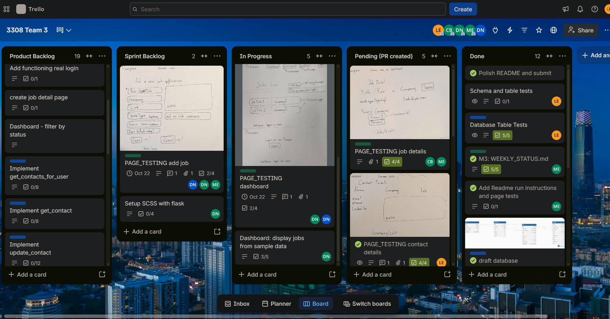
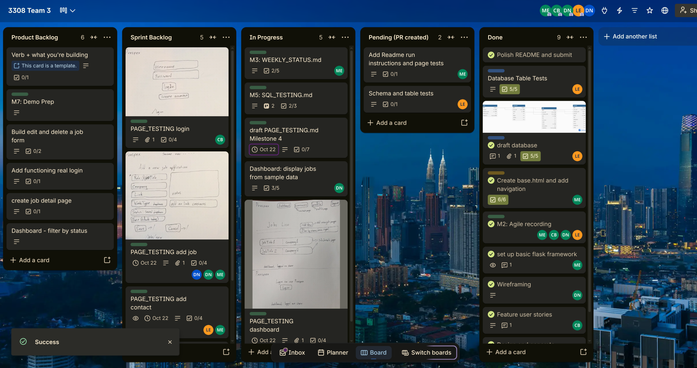
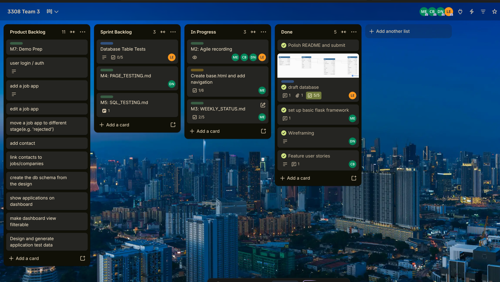

# Weekly Status: Prospex (Team 3)
-------
## October 21 Sprint 3 Review

**Meeting:** October 21, 3pm MT, 30 Minutes, Zoom. Scrum master: Leeza Etzenhouser

**Sprint Goal:**  PAGE_TESTING.md complete, additional progress on pages tbd once requirements ironed out.

**Next Sprint Goal** 

| Team member | Completed this sprint | Plan for next Sprint | Blocks |
| --- | --- | --- | --- | 
| Matthew Etter |  |  |  |
| Connor Brown | |   |  |
| Leeza Etzenhouser |  | |  |
| Dane Neves |  |  |  |

**Decisions:** 

**Risks:** 

**Retro:** 
- Went well: 
- Didn't work: 
- Changing next sprint: 
-------

## October 14 Sprint 2 Review

**Meeting:** October 7, 3pm MT, 30 Minutes, Zoom. Scrum master: Connor Brown

**Sprint Goal:**  sample data set, db schema + tests, base template and stub routes, started on page work. Dashboard view and PAGES_TESTING.md in progress.

**Next Sprint Goal** PAGE_TESTING.md complete, additional progress on pages tbd once requirements ironed out.

| Team member | Completed this sprint | Plan for next Sprint | Blocks |
| --- | --- | --- | --- | 
| Matthew Etter | base template with stub routes, README run steps, WEEKLY STATUS.md | mockups, detailed page descriptions | None |
| Connor Brown | Created Sample Test Data set| Login page, job details page   | mockups |
| Leeza Etzenhouser | schema.sql and db tests | contacts page, add contacts page| mockups |
| Dane Neves | Created dynamic jobs list on dashboard with sample data | add job, dashboard | mockups |

**Decisions:** Matt does mockups, split technical page details between other three. Add 'Pending (PR Created)' column to Trello

**Risks:** Diverging page design, referencing different names for same function in design

**Retro:** 
- Went well: Division of labor worked without conflict, db tests up and running with sample data, dashboard routes passing basic test
- Didn't work: still getting up to speed on Trello, better than last week on that front.
- Changing next sprint: Created Trello template, adding Pending (PR Created) column

-------

## October 7 Sprint 1 Review

**Meeting:** October 7, 3pm MT, 30 Minutes, Zoom. Scrum master: Dane Neves

**Sprint Goal:** Draft database, Wireframe, Get Flask Skeleton running, Create user stories. 

| Team member | Completed this sprint | Plan for next Sprint | Blocks |
| --- | --- | --- | --- | 
| Matthew Etter | Flask Skeleton, login/logout, profile route | base template and navigation, README run steps, WEEKLY STATUS.md | Away till the 13th |
| Connor Brown | Created Detailed User Stories| Create Sample Test Data set  | None |
| Leeza Etzenhouser | SQL design doc: Tables and constraints and ER Diagram| Write db tests| None |
| Dane Neves | Wireframes for each page of application | Begin work on PAGE_TESTING.md | None | 

**Decisions:** Switched to SQLite from MySQL because it better matches class stack.

**Risks:** Difficulty integrating tests/ pages/ db

**Retro:** 
- Went well: PRs reviewed, code merged and working, design docs reviewed and discussed
- Didn't work: Not using Trello to potential
- Changing next sprint: Using Trello for communication more, assign members to cards and use cheklists

